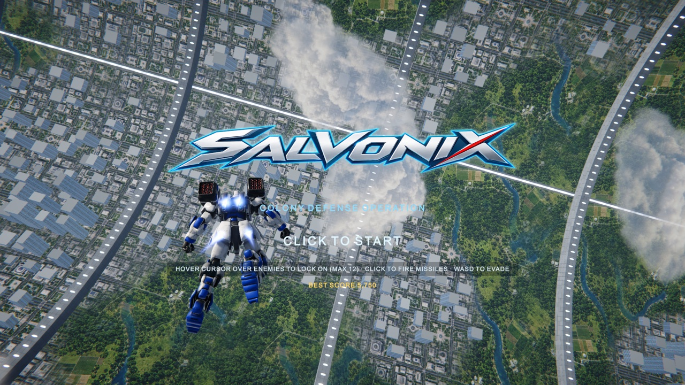
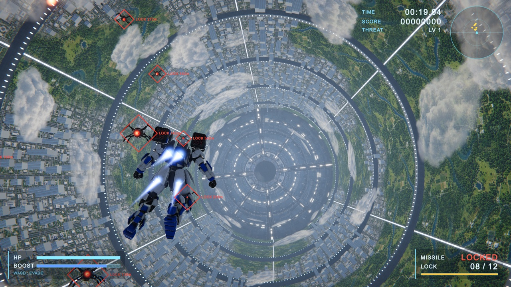
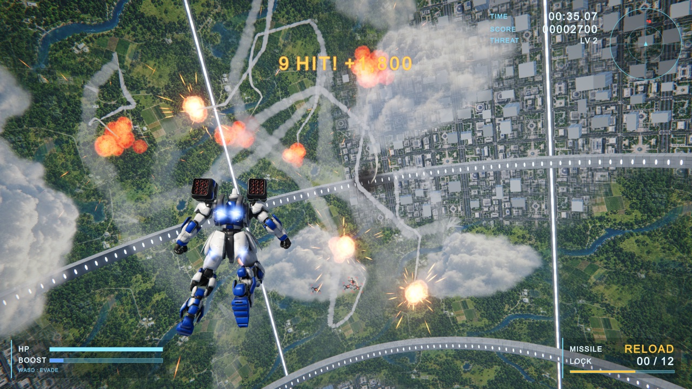

# Salvonix

**Salvonix** is a lock-on shooter set inside a cylindrical space colony. Your
mech flies on its own, swinging around the enemy swarm with dynamic maneuvers
and barrel rolls, so you can focus on the fight: sweep the cursor over enemies
to lock on to up to 12 targets, then click to unleash a salvo of homing micro
missiles that weave and intertwine on their way. The more enemies a single
salvo takes down, the bigger the bonus.

The project is built with Unity 6, and most of its assets (models, textures,
audio, logo) were produced with generative AI tools.

## Controls

- **Mouse** – Hover the cursor over enemies to lock on (max 12).
- **Left click** – Fire missiles at the locked targets. A reload period
  follows each salvo.
- **WASD / Arrow keys** – Evade enemy fire.
- **Esc** – Quit.

## Requirements

- Unity 6000.6.4f1 or later

## Runtime Overview

- `GameManager` – Game flow (title / playing / game over), score and
  difficulty.
- `FlightDirector` – Automatic flight control that alternates between hovering
  in front of the swarm and maneuvers around it.
- `PlayerMech` – WASD evasion, leaning, thruster effects and HP.
- `WeaponSystem`, `Missile` – Cursor lock-on, salvo launching and the homing
  missiles with spiraling trails.
- `EnemyManager`, `Enemy`, `BulletManager` – Enemy spawning, behavior (drones
  and heavies) and their energy bolts.
- `Colony`, `ColonyBuilder`, `ColonyEnvironment` – The procedurally built
  colony interior and its atmosphere.
- `CameraController`, `HudController`, `HudElements`, `FxManager`,
  `AudioManager` – Presentation.

## Scene Builder

The materials, prefabs and the main scene are generated from code. Run
**Salvonix > Build Scene** from the menu bar to rebuild `Assets/Main.unity`.
Edit `Assets/Editor/SalvonixSetup.cs` rather than the scene itself, since
changes made directly to the scene are lost on rebuild.
